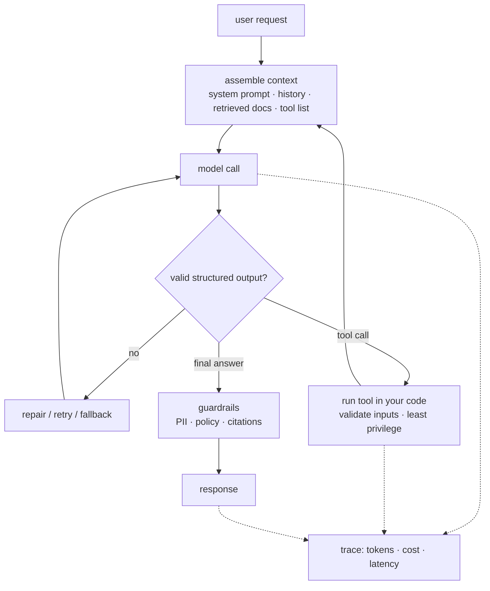
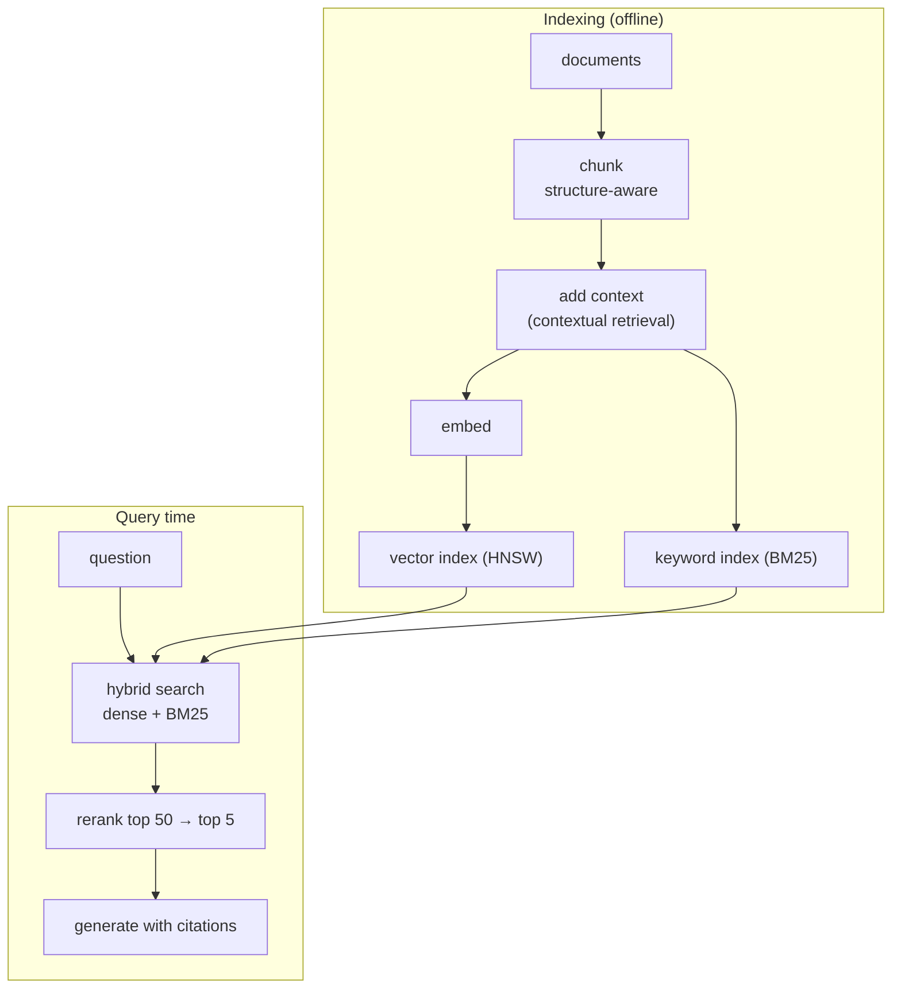
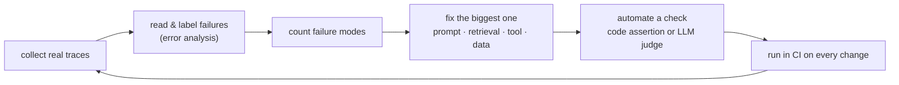

## The shape of an AI feature

Almost every AI feature is the same loop: assemble context, call a model, check the output, maybe call a tool, and log everything so you can evaluate it later. The model is one component. Most bugs live in the code and data around it.

## RAG, step by step

RAG has two halves. **Indexing** happens offline; **retrieval and generation** happen per request. Measure the two halves separately: if the right chunk never reaches the model, no prompt will save you.

Dense retrieval ranks chunks by cosine similarity between the query embedding $q$ and each chunk embedding $d$:

$$
\operatorname{sim}(q, d) = \frac{q \cdot d}{\lVert q \rVert \, \lVert d \rVert}
$$

Dense search finds paraphrases; keyword search finds exact names, error codes and IDs. That is why **hybrid search plus a reranker** beats either alone on most real document sets. Track retrieval with **recall@k**: the share of questions where at least one correct chunk is in the top $k$.

## Workflows before agents

Anthropic's *Building effective agents* makes a simple point: start with the least autonomous design that solves the problem.

| Pattern | What it is | Good for |
| --- | --- | --- |
| Prompt chain | fixed sequence of calls | tasks with clear steps |
| Router | classify, then send to a specialised prompt | mixed request types |
| Parallel | several calls at once, then combine | voting, independent sub-tasks |
| Orchestrator–workers | one model plans, others execute | tasks you can't split in advance |
| Agent | model decides the next step in a loop | open-ended tasks with tools |

Agents cost more, are slower and are harder to test. Use them when the path really can't be known in advance, and give them step and cost budgets.

## Tools and MCP

A tool is just a function with a name, a description and a JSON schema. The model *proposes* a call and your code runs it, so **your code is the security boundary**. Validate arguments, scope credentials to the user, and make destructive tools require confirmation.

The Model Context Protocol standardises this: an MCP *server* exposes tools, resources and prompts, and any MCP *client* (an IDE, a chat app, your own agent) can use them. If you already build APIs and integrations, MCP servers are a natural next step. Treat them like any public API: authentication, rate limits, input validation and audit logs.

## The eval loop

Evals are how you know a change helped. The practice that works is boring and manual at first:

1. **Look at data first.** Read 50–100 traces and write down what went wrong, in your own words.
2. **Prefer code checks** (valid JSON? cited a retrieved chunk? called the right tool?) over judges where you can.
3. **For judges, use binary pass/fail** with a short rubric, and measure agreement with your own labels before trusting them.
4. **Keep a held-out set** you never tune prompts against, so you can tell real improvement from overfitting.

## Cost and latency budgets

A rough per-request cost is

$$
\text{cost} \approx n_{\text{in}} \cdot p_{\text{in}} + n_{\text{out}} \cdot p_{\text{out}}
$$

where $n$ are token counts and $p$ the per-token prices. Output tokens usually cost several times more than input tokens and dominate latency, because they are generated one at a time. The levers, roughly in order of effort: shorter outputs, prompt caching for stable prefixes, a smaller model for easy steps (routing), batching offline work, and only then fine-tuning or distillation.

## The forward-deployed engineer

A fast-growing role combines everything above with customer work: sit with a customer, find the workflow worth automating, connect an agent to their systems (identity, APIs, data), and prove it works with evals they believe. It rewards integration experience, clear writing and the ability to say *no* to an agent when a workflow would do.
