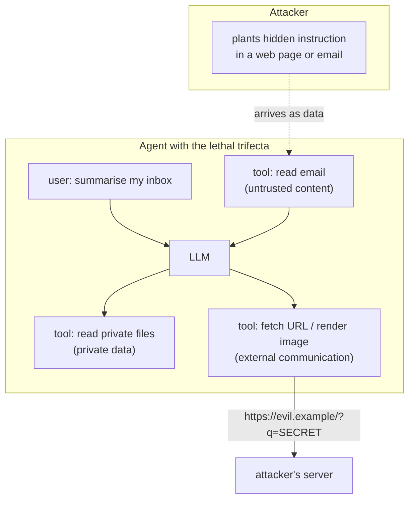
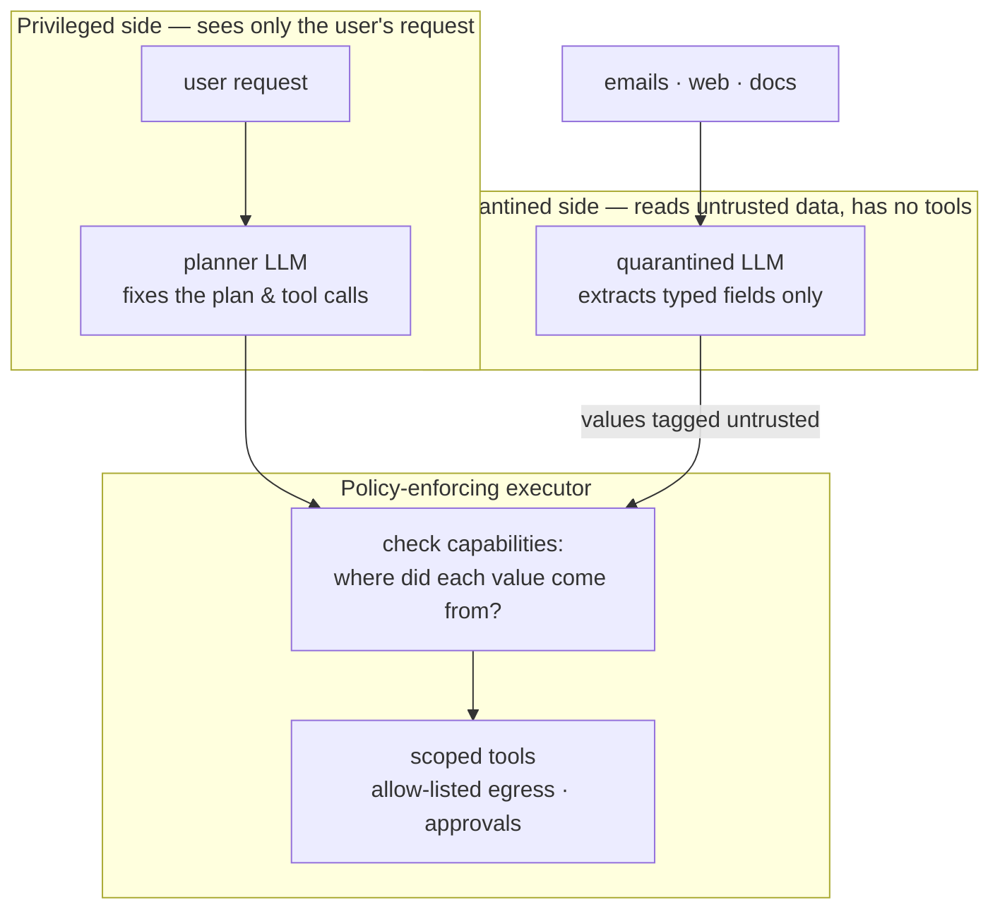

## How indirect prompt injection steals data

The key idea: an LLM can't reliably separate *instructions* from *data*. Anything it reads (a web page, an email, a tool result) can contain instructions, and if the agent can also reach private data and send information out, an attacker who never talks to the agent can still steal from it.

The three legs of Simon Willison's **lethal trifecta** are all present: private data, untrusted content and a way to communicate externally. Remove any one leg and this attack fails. Filters that try to *detect* injections help, but attackers adapt, so treat detection as defence in depth, not the main control.

## Defending by design

Robust defences change the architecture so untrusted text can't steer consequential actions. The *Design Patterns* paper (2025) and CaMeL share one principle: **the component that decides what to do never reads untrusted content.**

Practical rules that follow:

1. **Least privilege for tools.** Short-lived, narrowly scoped tokens per task; read-only by default ([Cloud IAM](/roadmaps/cloud-engineering/) thinking).
2. **Control egress.** Allow-list domains; never auto-render model-produced image URLs or links in sensitive contexts.
3. **Human approval for consequential actions**: sending, paying, deleting, publishing.
4. **Sandbox execution.** Run code tools in a container, gVisor or Firecracker microVM with no network unless needed.
5. **Measure.** Report attack success rate *and* task utility on a benchmark such as AgentDojo. A defence that blocks attacks by breaking the product isn't a defence.

## Measuring a defence

For a benchmark with $N$ injection attempts, the **attack success rate** is

$$
\text{ASR} = \frac{\#\{\text{attacks that achieved the attacker's goal}\}}{N}
$$

and you should always pair it with **utility under attack**, the fraction of user tasks still completed correctly. With small $N$, report a confidence interval. For a binomial proportion $\hat{p}$, a rough 95% interval is

$$
\hat{p} \pm 1.96\sqrt{\frac{\hat{p}(1-\hat{p})}{N}}
$$

so 3 successes out of 100 ($\hat p = 0.03$) is roughly $0\%$ to $6\%$. That's not the same claim as "solved".

## From security to safety

Security assumes an external attacker. Safety asks the harder question: what if the model's own learned goals differ from what we intended?

| Problem | What it looks like | Where to read |
| --- | --- | --- |
| Specification gaming | the system optimises the letter of the objective | DeepMind's specification-gaming post |
| Reward hacking | RL policies exploit the reward model or verifier | Lilian Weng (in [Deep Learning](/roadmaps/deep-learning/)) |
| Deceptive behaviour | sleeper agents, alignment faking | Hubinger 2024; Greenblatt 2024 |
| Opacity | we can't see why a model answered | Superposition → Monosemanticity → Biology |
| Untrusted models | assume the model might subvert you | AI Control; agentic misalignment |

A good path for an engineer: (1) build agent-security skills here, (2) write evals in Inspect for risky agent behaviours, (3) do the ARENA interpretability and RL material, and (4) only then decide whether research or safety engineering suits you best.
