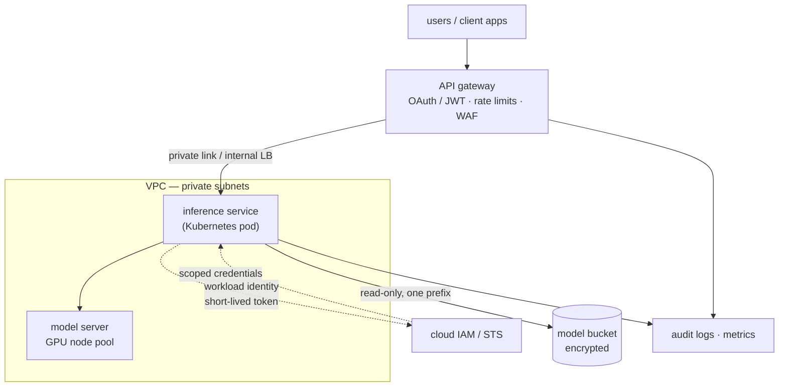
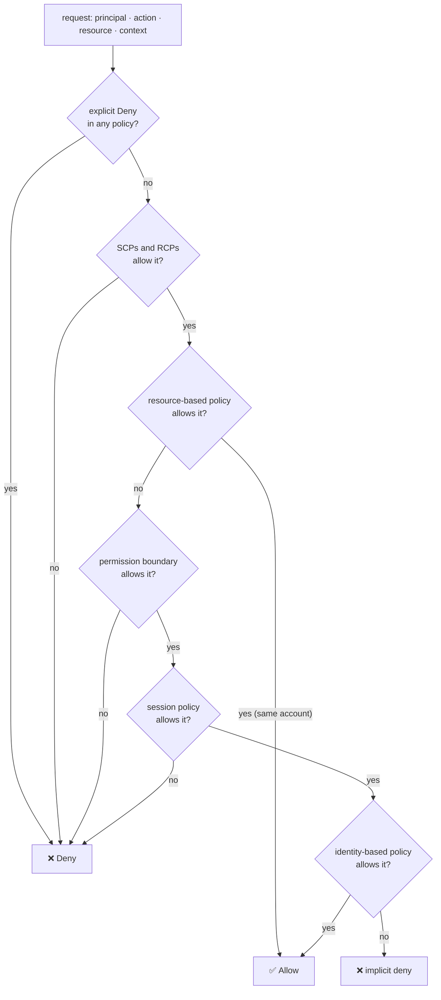
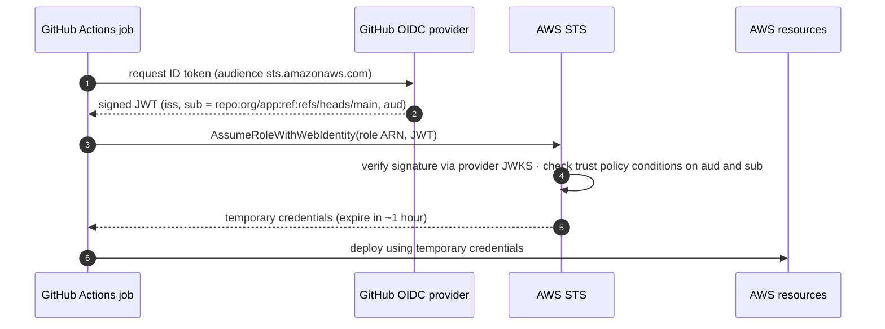

## The shape of a secure cloud deployment

Before the details, keep one picture in mind. Traffic enters through a few controlled doors (load balancer, API gateway). Services live in private subnets. Every service has its **own identity**, and that identity gets exactly the permissions it needs, nothing else. Credentials are short-lived and issued on demand.



Read the arrows as questions you must be able to answer: *who is calling, how is that proven, and what exactly can they do?*

## IAM vocabulary across clouds

The ideas are shared; the names are not.

| Concept | AWS | Google Cloud | Azure |
| --- | --- | --- | --- |
| Human identity | IAM Identity Center user / IAM user | Google account / Cloud Identity | Entra ID user |
| Workload identity | IAM role (assumed) | Service account | Managed identity / workload identity |
| Permission bundle | Policy (JSON) | Role (set of permissions) | Role definition |
| Granting | Attach policy to principal or resource | IAM binding on a resource | Role assignment at a scope |
| Org-wide guardrail | SCP / RCP | Organization policy / deny policy | Azure Policy |
| Keyless federation | `AssumeRoleWithWebIdentity` | Workload Identity Federation | Federated identity credentials |
| Audit trail | CloudTrail | Cloud Audit Logs | Activity log |

## How AWS decides: policy evaluation

When a request arrives, AWS gathers every policy that applies and evaluates them together. The rules are simple to state and easy to get wrong:

1. Everything starts as **implicitly denied**.
2. An **explicit `Deny`** in any policy ends the evaluation: denied.
3. Guardrails (**SCPs** and **RCPs** from AWS Organizations) must allow the action, or it's denied.
4. **Permission boundaries** and **session policies** cap what the principal can do.
5. An **identity-based** or (within an account) **resource-based** policy must actually grant it.



This is a simplified view. Cross-account requests need both sides to allow, and some resource-policy cases differ, so keep the [official evaluation-logic page](https://docs.aws.amazon.com/IAM/latest/UserGuide/reference_policies_evaluation-logic.html) open while you learn. The habit that matters: when something is denied, walk the layers in order instead of adding `*` until it works.

## Least privilege, written down

A good policy names specific actions, specific resources and conditions. This one lets an inference service read model files under one prefix, only over TLS and only through the VPC endpoint:

```json
{
  "Version": "2012-10-17",
  "Statement": [
    {
      "Sid": "ReadModelWeights",
      "Effect": "Allow",
      "Action": ["s3:GetObject"],
      "Resource": "arn:aws:s3:::acme-models/sentiment/v3/*",
      "Condition": {
        "Bool": { "aws:SecureTransport": "true" },
        "StringEquals": { "aws:SourceVpce": "vpce-0abc123def4567890" }
      }
    },
    {
      "Sid": "ListOnlyThatPrefix",
      "Effect": "Allow",
      "Action": ["s3:ListBucket"],
      "Resource": "arn:aws:s3:::acme-models",
      "Condition": { "StringLike": { "s3:prefix": ["sentiment/v3/*"] } }
    }
  ]
}
```

Notice what's missing: no `s3:*`, no `PutObject`, no other buckets. To get there in practice, start broad in a sandbox, let IAM Access Analyzer generate a policy from real CloudTrail activity, then tighten and test the denials too.

## Keyless CI/CD with OIDC federation

The old way stored an access key as a CI secret: long-lived, copyable, and rarely rotated. The modern way lets the CI platform *prove who it is* with a signed OIDC token and swaps that token for short-lived cloud credentials.



The security lives in the role's **trust policy**: it must check `aud` and pin `sub` to your repository *and* branch (or environment). A trust policy that only checks the issuer would let any GitHub repository assume your role. Google Cloud's Workload Identity Federation follows the same pattern with an attribute condition on the pool provider.

The same idea powers workload identity inside Kubernetes: EKS (IRSA or Pod Identity) and GKE Workload Identity Federation let a pod's service account become a cloud principal, so no node ever holds a key.

## OAuth 2.0, OIDC and JWTs in one page

- **OAuth 2.0** is about *delegated authorization*: a client gets an **access token** to call an API on someone's behalf, with limited **scopes**.
- **OpenID Connect** adds *authentication* on top: an **ID token** (a JWT) says who the user is, for the client to read.
- A **JWT** is `header.payload.signature`. Validating it means checking the signature against the issuer's keys, and `iss`, `aud`, `exp` (and `nbf`). Skipping `aud` lets a token minted for another app be replayed against yours.
- **Token exchange** (RFC 8693) lets a service trade one token for another with narrower scope or a different audience. That's useful when an agent or service calls a downstream API *on behalf of* a user.
- Follow **RFC 9700**: use authorization code + PKCE, no implicit grant, short-lived tokens, exact redirect-URI matching.

API gateways such as WSO2 API Manager, Apigee and AWS API Gateway do this validation at the edge, but services behind them should still check the claims they rely on.

## Authorization beyond IAM: RBAC, ABAC, ReBAC

Cloud IAM protects cloud resources. Your *application* needs its own authorization model:

- **RBAC:** permissions attached to roles (`admin`, `editor`). Simple, but role explosion follows.
- **ABAC:** decisions on attributes (`department == resource.department`). Flexible, harder to audit.
- **ReBAC:** decisions on relationships (*user is editor of folder, folder contains doc*). This is Google Zanzibar's model, and it fits sharing features well.

Keep these rules out of `if` statements scattered through the code. Put them in a policy engine (**OPA/Rego** or **Cedar**), test them in CI, and log every decision.

## Availability and cost: the arithmetic

Components in series multiply their availabilities; redundant replicas in parallel multiply their *failure* probabilities:

$$
A_{\text{series}} = \prod_{i} A_i \qquad\qquad A_{\text{parallel}} = 1 - \prod_{i} \left(1 - A_i\right)
$$

A gateway (99.95%) → service (99.9%) → database (99.95%) chain gives about 99.8%, or roughly 17.5 hours of downtime a year. Two independent service replicas at 99.9% each give 99.9999% for that tier.

For cost, think in **unit economics**, not monthly totals:

$$
\text{cost per 1k requests} = \frac{\text{instance cost per hour}}{\text{requests served per hour}} \times 1000
$$

Unit costs make the levers obvious: right-size the instance, raise utilisation (batching, autoscaling), or buy cheaper capacity (commitments, spot). For GPU inference, the same formula with tokens instead of requests drives most decisions in the [Inference & GPU](/roadmaps/inference-gpu/) track.

## Zero trust in practice

Zero trust is not a product. It is three habits:

1. **Never trust the network.** Being inside the VPC grants nothing; every call carries an identity (mTLS with SPIFFE IDs, or signed tokens).
2. **Verify explicitly, every time.** Authenticate and authorise each request using identity, device and context.
3. **Assume breach.** Small blast radius per identity, short-lived credentials, full audit logs, and practised incident response.

BeyondCorp showed this works for a whole company; NIST SP 800-207 is the vocabulary for designing it. For AI agents, it becomes the rule that an agent gets its *own* scoped identity, never a human's broad credentials.
