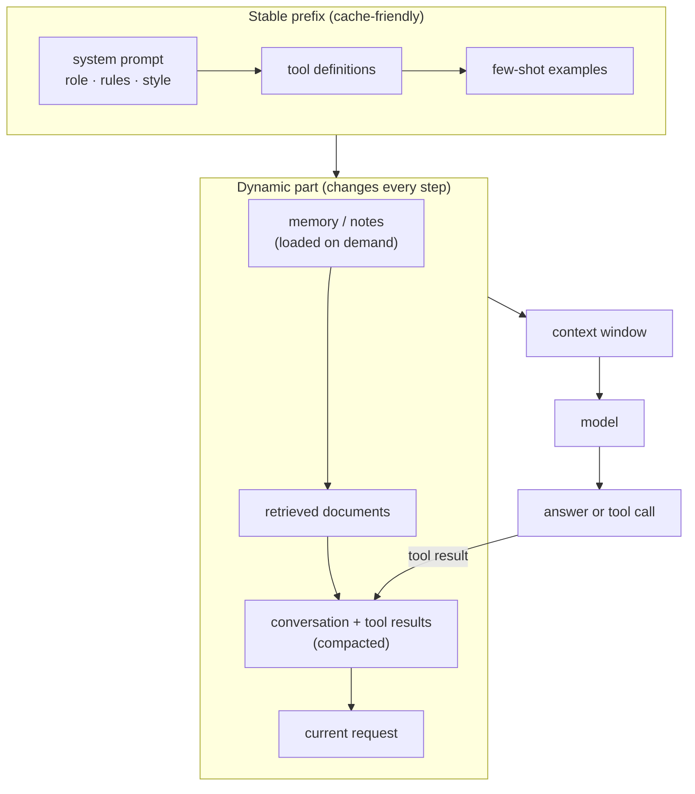

## From prompt to context

A prompt is one string. A context is everything the model sees on this call. In a modern agent, the part you wrote by hand is often a small fraction of the window; the rest is history, retrieved data and tool output that changes every step.

Order matters for two reasons. Keeping the **stable parts first** lets the serving engine reuse its KV cache across calls (cheaper and faster). Putting the **current request last**, close to where the model starts generating, avoids it being lost in the middle.

## A context budget

Treat the window like memory in a small device. If the window holds $W$ tokens and you need room for the answer:

$$
T_{\text{system}} + T_{\text{tools}} + T_{\text{examples}} + T_{\text{memory}} + T_{\text{retrieved}} + T_{\text{history}} + T_{\text{answer}} \le W
$$

Fitting is not the goal, though. Quality usually drops well before the limit, so set your own budget for each component (for example "retrieved docs ≤ 8k tokens, history compacted above 30k") and log the actual numbers. A useful signal is the share of the window that is *relevant* to the current step:

$$
\text{signal ratio} = \frac{\text{tokens the step actually needs}}{\text{tokens in context}}
$$

You can't measure the numerator exactly, but asking the question changes your design: fewer tools, shorter tool results, and retrieval on demand instead of pasting everything in.

## Prompting techniques that still matter

- **Be specific about the output.** Give a schema, an example, and what to do when the answer is unknown.
- **Use structure.** Wrap documents, examples and instructions in clear tags so the model can tell them apart.
- **Show, don't just tell.** Two or three varied examples often beat a paragraph of rules.
- **Let it think when it helps.** Chain-of-thought helps non-reasoning models on multi-step problems; reasoning models already do this internally, so focus on clear goals and constraints instead.
- **Test, don't guess.** Every technique helps on some tasks and hurts on others. Your test set decides.

## Why long contexts fail

| Failure | What happens | Typical fix |
| --- | --- | --- |
| Poisoning | a hallucination or error enters context and gets repeated | validate tool results; let the agent re-check facts |
| Distraction | long history makes the model repeat past actions | compaction; fresh sub-agent windows |
| Confusion | irrelevant tools or documents get used | fewer tools; better retrieval; filter results |
| Clash | contradictory information in context | remove outdated facts; mark sources and dates |
| Rot | accuracy falls as length grows, even on easy tasks | keep context short; just-in-time retrieval |

## Managing context over a long run

Three tools cover most cases:

1. **Compaction.** When history grows past a threshold, summarise it, keeping decisions, unresolved issues and exact identifiers (file paths, IDs). Drop raw tool output first.
2. **Notes.** Let the agent write progress to a file or memory store (`NOTES.md`, a TODO list) and read it back. This survives compaction and even new sessions.
3. **Sub-agents.** Send a focused sub-task to a fresh window. The sub-agent may read 50k tokens; the parent receives 500.

## Optimising prompts automatically

Once you have a reliable eval, you can let software search for better prompts. DSPy expresses a pipeline as typed modules and uses optimisers (including GEPA) to choose instructions and examples. The risk is the same as in ML: **overfitting to your dev set**. Keep a held-out set, compare across several runs, and re-check when you switch models.
