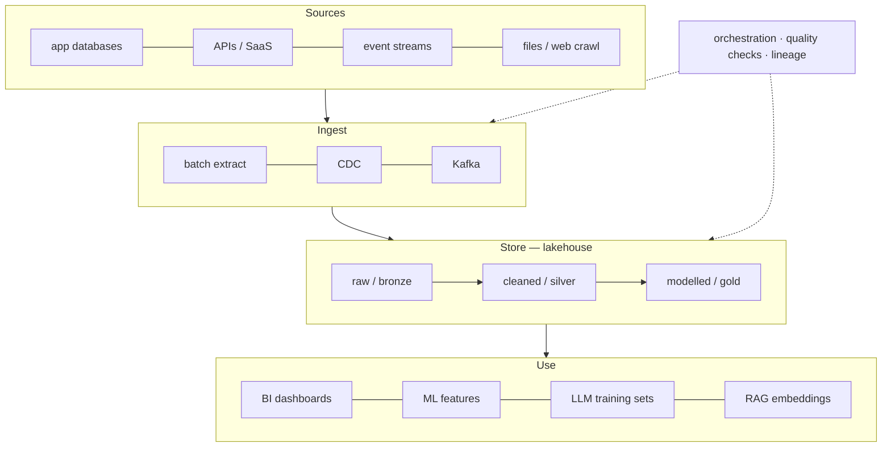
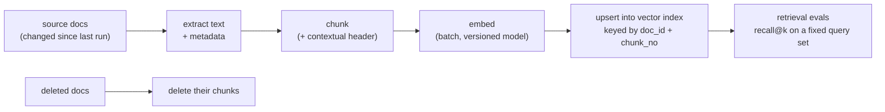

## The modern data stack at a glance

Data flows from sources, through ingestion and storage, into transformations that produce trusted datasets for analytics *and* for AI.



The **medallion** layers (bronze → silver → gold) are just a discipline: keep raw data immutable so you can always rebuild, clean in a separate step, and model for consumers last.

## Idempotency is the whole game

A pipeline will be retried, backfilled and re-run by someone at 2 a.m. Design so that running it twice gives the same result as running it once:

- **Overwrite partitions** (e.g. `date=2026-11-07`) instead of appending blindly.
- **Merge on a key** (`MERGE INTO … ON id`) for upserts.
- **Deduplicate on a stable event ID** in streaming sinks.

```sql
-- Keep the latest version of each order, safe to re-run any time
CREATE OR REPLACE TABLE silver.orders AS
SELECT * EXCLUDE (rn)
FROM (
  SELECT *,
         ROW_NUMBER() OVER (PARTITION BY order_id ORDER BY updated_at DESC) AS rn
  FROM bronze.orders_raw
)
WHERE rn = 1;
```

## Batch, micro-batch or streaming?

| Requirement | Pick | Why |
| --- | --- | --- |
| Daily reports, model retraining | Batch | Simplest and cheapest; easy backfills |
| Dashboards fresh within minutes | Micro-batch | Near-real-time with batch semantics |
| Fraud checks, live features, alerts | Streaming | Event-at-a-time; needs watermarks and state |

Streaming adds real complexity (state, late data, exactly-once effects), so choose it only when the freshness requirement is real.

## Deduplication at web scale: MinHash

Training corpora contain huge numbers of near-duplicates (boilerplate, mirrors, templated pages), which waste compute and encourage memorisation. Comparing every pair of documents is impossible, so pipelines use **MinHash**.

Represent each document as a set of shingles (e.g. 5-word n-grams). The Jaccard similarity of two sets is

$$
J(A,B) = \frac{|A \cap B|}{|A \cup B|}
$$

and for a random hash function $h$, the probability that the minimum hash values match equals that similarity:

$$
\Pr\left[\min h(A) = \min h(B)\right] = J(A,B)
$$

So a signature of $k$ min-hashes estimates $J$ cheaply. **LSH banding** then splits the signature into $b$ bands of $r$ rows; two documents become candidates if any band matches, which happens with probability

$$
P(\text{candidate}) = 1 - \left(1 - s^{r}\right)^{b}
$$

for similarity $s$. Tuning $b$ and $r$ moves the S-shaped threshold, often to around $s \approx 0.8$. The FineWeb paper shows how much these choices matter for the final model.

## Embeddings pipelines for RAG

A RAG index is a derived dataset and should be treated like one: versioned, tested and kept fresh.



Common failure modes are pipeline bugs, not model bugs: stale chunks from deleted documents, mixing vectors from two embedding-model versions, or chunking that splits tables in half. Key each chunk deterministically, store the embedding model version with it, and run a small retrieval eval after every re-index.
