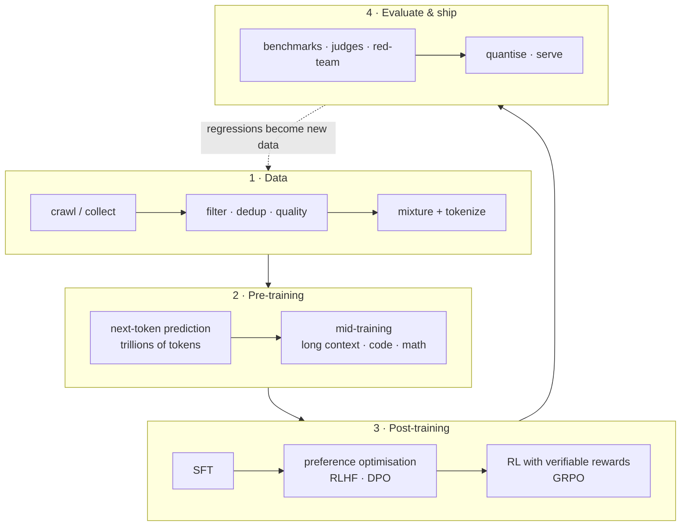
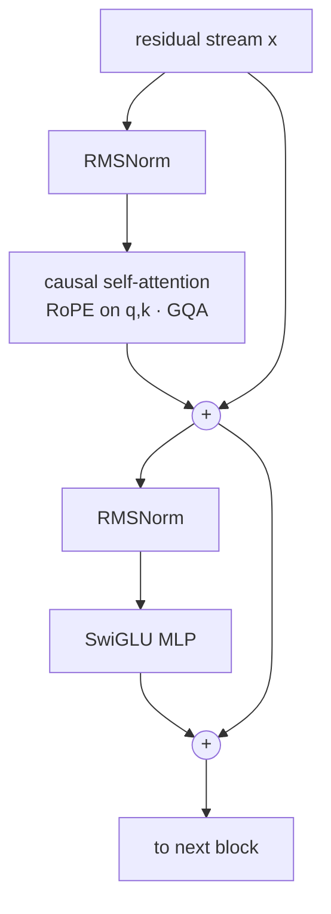
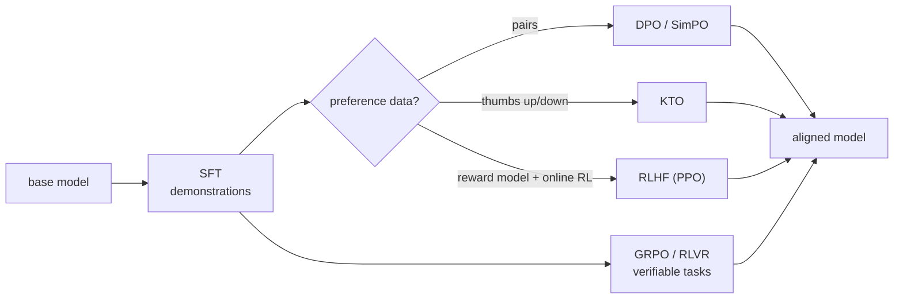

## The training pipeline at a glance

Every modern LLM goes through the same broad stages. Labs differ in the details (data, scale, the RL recipe), but the shape is the same. The roadmap above has you build each box yourself, at small scale.

## Learning is optimisation

A model with parameters $\theta$ takes a token sequence $x_{1:T}$ and is trained to predict each next token. Pre-training minimises the average **negative log-likelihood** (the cross-entropy):

$$
\mathcal{L}(\theta) = -\frac{1}{T}\sum_{t=1}^{T} \log p_\theta\left(x_t \mid x_{<t}\right)
$$

Perplexity is just $\exp(\mathcal{L})$. Gradient descent updates $\theta \leftarrow \theta - \eta \nabla_\theta \mathcal{L}$, and backpropagation computes $\nabla_\theta \mathcal{L}$ by applying the chain rule backwards through the computational graph. That's why building micrograd comes first: once you've written backprop yourself, `loss.backward()` stops being magic.

> **Rule of thumb:** when a run misbehaves, check in this order: data (look at real batches), learning rate, initialisation and normalisation, then numerics (overflow in fp16, missing loss scaling).

## Attention in one equation

Each token produces a query $q$, key $k$ and value $v$. Stacked into matrices, scaled dot-product attention is:

$$
\operatorname{Attention}(Q,K,V) = \operatorname{softmax}\left(\frac{QK^\top}{\sqrt{d_k}} + M\right)V
$$

$M$ is the causal mask ($-\infty$ above the diagonal), so a token can't see the future. The $\sqrt{d_k}$ keeps the dot products from growing with dimension and saturating the softmax. A modern decoder block wraps this as:

Attention costs $O(T^2)$ in sequence length. FlashAttention doesn't change that count; it reorganises the computation so the $T \times T$ matrix never sits in slow GPU memory. That's why reading the [Inference & GPU](/roadmaps/inference-gpu/) track pays off here.

## Back-of-the-envelope compute and memory

You should be able to estimate a run before launching it. For a dense Transformer with $N$ parameters trained on $D$ tokens:

$$
C_{\text{train}} \approx 6ND \ \text{FLOPs}
$$

The 6 is 2 FLOPs per parameter per token for the forward pass and about 4 for the backward pass. **Example:** GPT-2 small ($N \approx 124\text{M}$) on $D = 10\text{B}$ tokens needs about $7.4 \times 10^{18}$ FLOPs. At an achieved 40% of a GPU's ~1 PFLOP/s bf16 peak, that's roughly five GPU-hours.

Memory for mixed-precision training with AdamW is roughly **16 bytes per parameter** before activations: bf16 weights (2) + bf16 grads (2) + fp32 master weights (4) + two fp32 Adam moments (8). So a 7B model needs ~112 GB for weights and optimiser state alone. That's why ZeRO/FSDP sharding exists.

| Parallelism | What is split | Use it when |
| --- | --- | --- |
| Data (DDP) | the batch | the model fits on one GPU |
| FSDP / ZeRO-3 | weights, grads, optimiser state | the model *nearly* fits; the default first step |
| Tensor (TP) | matrices inside a layer | layers are too big; needs fast NVLink within a node |
| Pipeline (PP) | groups of layers | many nodes; accept pipeline "bubbles" |
| Context / sequence | the sequence dimension | very long contexts |
| Expert (EP) | MoE experts | Mixture-of-Experts models |

## Scaling laws: spend compute wisely

Kaplan et al. (2020) found loss falls as a power law in parameters, data and compute. Chinchilla (2022) fitted

$$
L(N, D) = E + \frac{A}{N^{\alpha}} + \frac{B}{D^{\beta}}
$$

and showed that, for a fixed budget, parameters and tokens should grow together: about **20 tokens per parameter**. Modern open models deliberately "over-train" far past that (Llama 3 8B saw ~15T tokens) because a smaller, longer-trained model is cheaper to *serve*. Training-optimal and deployment-optimal are different questions, and the Expert-stage scaling-law project makes this concrete.

## Post-training: from SFT to RL

**SFT** is the same next-token loss, applied only to the response tokens of curated (prompt, response) pairs in a chat template. It teaches format and behaviour.

**RLHF** (InstructGPT) trains a reward model $r_\phi$ on human preference pairs, then optimises the policy with PPO while a KL penalty keeps it near the SFT reference model:

$$
\max_{\pi_\theta}\ \mathbb{E}_{x,\,y\sim\pi_\theta}\left[r_\phi(x,y)\right] - \beta\, \mathrm{KL}\left(\pi_\theta(\cdot\mid x)\,\|\,\pi_{\text{ref}}(\cdot\mid x)\right)
$$

**DPO** shows this objective has a closed-form optimal policy, so you can skip the reward model and RL loop and train directly on preferred ($y_w$) and rejected ($y_l$) answers:

$$
\mathcal{L}_{\text{DPO}} = -\log \sigma\left(\beta \log\frac{\pi_\theta(y_w\mid x)}{\pi_{\text{ref}}(y_w\mid x)} - \beta \log\frac{\pi_\theta(y_l\mid x)}{\pi_{\text{ref}}(y_l\mid x)}\right)
$$

**GRPO** (DeepSeekMath, then DeepSeek-R1) drops PPO's value network. For each prompt it samples a *group* of $G$ answers, scores them (often with a verifiable reward: did the math answer match? did the tests pass?) and uses the group-normalised score as the advantage:

$$
\hat{A}_i = \frac{r_i - \operatorname{mean}(r_{1..G})}{\operatorname{std}(r_{1..G})}
$$

This is RL with verifiable rewards (RLVR), the recipe behind 2025-era reasoning models. Its failure modes are worth studying as much as its successes: reward hacking, exploding response length, and the normalisation biases that DAPO and Dr. GRPO correct.

## Evaluation is part of training

A training run without evals is a vibe. Build the habit early:

1. **Track held-out loss and a few cheap downstream evals during training**, not just at the end.
2. **Check for contamination:** n-gram overlap between your training data and benchmark test sets.
3. **Report uncertainty.** Small benchmarks have wide confidence intervals; run several seeds where you can.
4. **Use LLM judges carefully:** swap answer positions, control for length, and spot-check by hand (MT-Bench paper).
5. **Write at least one eval nobody else has**, such as Sinhala QA or your domain's tasks. Public benchmarks saturate; private evals tell you the truth.
