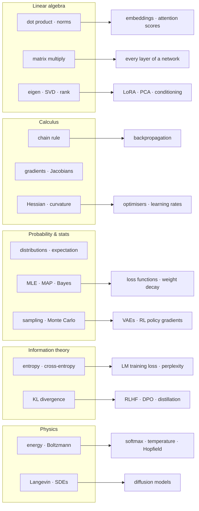
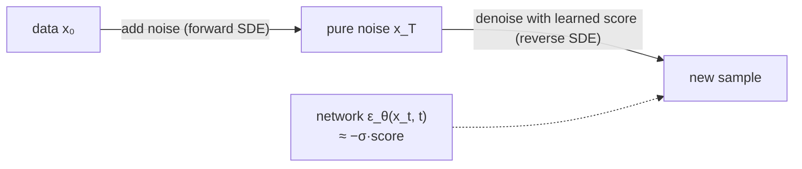

## The concept map

You don't need all of mathematics. You need these ideas, and you need to see *where each one lives* in a model. Read the map left to right: each box is something you learn, and the arrow points to where it shows up in ML.

## Linear algebra: the language of layers

A dense layer is a matrix–vector product plus a bias:

$$
h = \sigma(Wx + b), \qquad W \in \mathbb{R}^{d_\text{out} \times d_\text{in}}
$$

**Why it matters — embeddings and attention.** An embedding is a vector, and "similar meaning" is measured with the dot product or cosine similarity:

$$
\cos(u, v) = \frac{u^\top v}{\lVert u \rVert\, \lVert v \rVert}
$$

That is the whole of vector search in [AI Engineering](/roadmaps/ai-engineering/), and attention scores $QK^\top$ are just a matrix of dot products between queries and keys.

**Why it matters — SVD and LoRA.** Any matrix factorises as $W = U \Sigma V^\top$, where the singular values in $\Sigma$ say how much each direction matters. Keeping only the top $r$ gives the best rank-$r$ approximation (Eckart–Young). LoRA bets that the *change* needed to fine-tune a model is low-rank too:

$$
W' = W + \Delta W = W + BA, \qquad B \in \mathbb{R}^{d \times r},\ A \in \mathbb{R}^{r \times k},\ r \ll \min(d, k)
$$

For a $4096 \times 4096$ matrix and $r = 16$, that's about $131\text{k}$ trainable numbers instead of $16.8\text{M}$, a 128× reduction.

**Why it matters — eigenvalues and conditioning.** For a symmetric matrix, the eigen-decomposition $A = Q\Lambda Q^\top$ tells you how it stretches space. The *condition number* $\kappa = \lambda_\text{max} / \lambda_\text{min}$ of a loss surface's curvature decides how fast gradient descent converges: high $\kappa$ means a long, narrow valley and zig-zagging steps. This is why normalisation layers and adaptive optimisers like Adam exist.

## Calculus: the chain rule *is* backpropagation

For a composition $L = f(g(h(x)))$ the chain rule says

$$
\frac{\partial L}{\partial x} = \frac{\partial f}{\partial g}\cdot\frac{\partial g}{\partial h}\cdot\frac{\partial h}{\partial x}
$$

A neural network is a long composition of layers, so the gradient of the loss with respect to any weight is a product of local derivatives. **Backpropagation** is just computing that product right to left, reusing intermediate results. That's why it costs about as much as one forward pass, rather than one pass *per parameter*.

With vectors, each local derivative becomes a **Jacobian** matrix $J_{ij} = \partial y_i / \partial x_j$, and backprop multiplies vectors by Jacobians ("vector–Jacobian products"). The single most useful result to derive yourself is the softmax cross-entropy gradient. With logits $z$, probabilities $p = \operatorname{softmax}(z)$ and one-hot target $y$:

$$
\frac{\partial}{\partial z}\left(-\sum_k y_k \log p_k\right) = p - y
$$

It's beautifully simple, and it's the gradient at the top of every language model.

**Second order.** The Hessian $H = \nabla^2 L$ describes curvature. Near a minimum, $L(\theta + \delta) \approx L(\theta) + \tfrac12 \delta^\top H \delta$; the largest eigenvalue of $H$ caps the stable learning rate at about $2/\lambda_\text{max}$. Learning-rate warmup and "edge of stability" effects are about this number.

## Probability: every loss is a likelihood

**Maximum likelihood.** Given data $\{x_i\}$ and a model $p_\theta$, MLE picks

$$
\theta^\star = \arg\max_\theta \sum_i \log p_\theta(x_i) = \arg\min_\theta \underbrace{-\frac1n \sum_i \log p_\theta(x_i)}_{\text{negative log-likelihood}}
$$

**Why it matters.** If the model outputs a categorical distribution, the NLL *is* cross-entropy, the loss of every classifier and language model. If it outputs a Gaussian mean with fixed variance, the NLL is (up to constants) mean-squared error. Choosing a loss means choosing a noise model.

**MAP and weight decay.** Adding a prior $p(\theta)$ and maximising the posterior gives MAP:

$$
\arg\max_\theta \left[\log p(\text{data}\mid\theta) + \log p(\theta)\right]
$$

With a Gaussian prior $\theta \sim \mathcal{N}(0, \sigma^2 I)$, $\log p(\theta) = -\frac{1}{2\sigma^2}\lVert\theta\rVert^2 + \text{const}$, which is exactly **L2 weight decay**. A Laplace prior gives L1 (sparsity).

**Statistics for evals.** A benchmark score is an estimate. With $n$ questions and accuracy $\hat p$, the standard error is $\sqrt{\hat p(1-\hat p)/n}$; on 500 questions at 70%, that's about ±2 points (95% interval ≈ ±4). Many "improvements" on small eval sets are noise.

## Optimisation: from gradient descent to Adam

Plain gradient descent is $\theta_{t+1} = \theta_t - \eta \nabla L(\theta_t)$. Stochastic gradient descent uses a mini-batch estimate of $\nabla L$, which is noisy but cheap and, helpfully, acts as a regulariser.

Adam keeps running averages of the gradient and its square:

$$
m_t = \beta_1 m_{t-1} + (1-\beta_1) g_t,\quad v_t = \beta_2 v_{t-1} + (1-\beta_2) g_t^2,\quad \theta_{t+1} = \theta_t - \eta\,\frac{\hat m_t}{\sqrt{\hat v_t} + \epsilon}
$$

Dividing by $\sqrt{v_t}$ rescales each coordinate. It's a cheap, diagonal stand-in for curvature, which helps on the ill-conditioned surfaces from the linear algebra section.

**Convexity.** For convex problems (linear and logistic regression, SVMs) every local minimum is global, and theory guarantees convergence. Deep networks aren't convex, but convex ideas still guide practice: Lagrange multipliers explain constrained objectives like the KL-constrained RLHF problem, and duality explains why some losses have closed-form optima.

## Information theory: entropy, cross-entropy and KL

The **entropy** of a distribution is its average surprise, $H(p) = -\sum_x p(x)\log p(x)$. The **cross-entropy** of model $q$ under true distribution $p$ is $H(p, q) = -\sum_x p(x)\log q(x)$, and the gap between them is the **KL divergence**:

$$
\mathrm{KL}(p\,\|\,q) = \sum_x p(x)\log\frac{p(x)}{q(x)} = H(p, q) - H(p) \ \ge 0
$$

**Why it matters — three places you'll meet KL:**

1. **Language-model training.** $H(p)$ of the data is fixed, so minimising cross-entropy minimises $\mathrm{KL}(p_\text{data}\,\|\,p_\theta)$. Perplexity $= e^{H}$ is "how many tokens the model is effectively choosing between".
2. **RLHF and DPO.** The objective $\mathbb{E}[r(x,y)] - \beta\,\mathrm{KL}(\pi_\theta\,\|\,\pi_\text{ref})$ rewards good answers but charges for drifting from the reference model. DPO's loss comes straight from the closed-form optimum of this objective (see [Deep Learning](/roadmaps/deep-learning/)).
3. **Distillation and VAEs.** Knowledge distillation minimises KL between teacher and student distributions; a VAE's ELBO contains a KL term that keeps the latent code close to a prior.

KL is *asymmetric*. $\mathrm{KL}(p\|q)$ ("forward", mass-covering) punishes $q$ for missing modes of $p$; $\mathrm{KL}(q\|p)$ ("reverse", mode-seeking) punishes $q$ for putting mass where $p$ has none. The direction you choose changes the behaviour you get.

## Physics I: energy, temperature and the Boltzmann distribution

Statistical mechanics says a system in equilibrium at temperature $T$ occupies state $x$ with probability

$$
p(x) = \frac{e^{-E(x)/T}}{Z}, \qquad Z = \sum_{x'} e^{-E(x')/T}
$$

**Why it matters — softmax is a Boltzmann distribution.** Set the energy to the negative logit, $E_k = -z_k$, and you get $p_k = e^{z_k/T} / \sum_j e^{z_j/T}$: softmax with temperature. That's why sampling "temperature" behaves like physical temperature. $T \to 0$ freezes into the single lowest-energy (highest-logit) token; large $T$ melts toward uniform randomness.

**Energy-based models** define $p_\theta(x) \propto e^{-E_\theta(x)}$ with a learned energy. The hard part is always the partition function $Z$, a sum over every possible $x$. Much of generative modelling is clever ways to avoid computing it: contrastive losses, score matching, and diffusion.

## Physics II: Hopfield networks and attention

A Hopfield network stores patterns as low points of an energy function over binary states $s$:

$$
E(s) = -\tfrac12 \sum_{i,j} w_{ij}\, s_i s_j, \qquad w_{ij} = \sum_\mu \xi_i^\mu \xi_j^\mu
$$

Updating each neuron to lower $E$ slides the state downhill into the nearest stored memory $\xi^\mu$. That is associative memory, and it's part of why Hopfield shared the 2024 Nobel Prize in Physics.

*Modern* Hopfield networks (Ramsauer et al., 2020) use an exponential energy with continuous states, and their one-step update for a query $\xi$ against stored patterns $X$ is

$$
\xi^\text{new} = X\,\operatorname{softmax}\!\left(\beta X^\top \xi\right)
$$

which is exactly Transformer attention with $\beta = 1/\sqrt{d_k}$. Attention can be read as one step of energy minimisation that retrieves the stored pattern best matching the query.

## Physics III: diffusion as a stochastic process

Brownian motion adds Gaussian noise continuously. A **diffusion model** defines a forward process that gradually turns data into noise, in discrete form (DDPM):

$$
q(x_t \mid x_{t-1}) = \mathcal{N}\!\left(x_t;\ \sqrt{1-\beta_t}\,x_{t-1},\ \beta_t I\right)
$$

or in continuous time as a stochastic differential equation, $dx = f(x,t)\,dt + g(t)\,dw$. Remarkably, the process has a **reverse-time SDE** that turns noise back into data, and it needs only the **score** $\nabla_x \log p_t(x)$:

$$
dx = \left[f(x,t) - g(t)^2\,\nabla_x \log p_t(x)\right]dt + g(t)\,d\bar w
$$

A neural network learns that score, which in practice is the same as predicting the added noise. DDPM's training loss is then strikingly simple:

$$
\mathcal{L} = \mathbb{E}_{t,\,x_0,\,\epsilon}\left[\lVert \epsilon - \epsilon_\theta(\sqrt{\bar\alpha_t}\,x_0 + \sqrt{1-\bar\alpha_t}\,\epsilon,\ t)\rVert^2\right]
$$

**Langevin dynamics** is the physics behind sampling. Follow the score uphill while adding noise,

$$
x_{k+1} = x_k + \frac{\eta}{2}\nabla_x \log p(x_k) + \sqrt{\eta}\,z_k, \qquad z_k \sim \mathcal{N}(0, I)
$$

and the particles end up distributed according to $p$. **Flow matching** (2022) learns a deterministic velocity field instead, so generation becomes solving an ODE with fewer steps.

## How to study this track

1. **Intuition, then formalism, then code.** Watch the 3Blue1Brown video, read the MML chapter, then verify the result numerically in NumPy.
2. **Derive the six workhorse results yourself:** softmax cross-entropy gradient, MSE as Gaussian NLL, L2 as a Gaussian prior, the DPO loss, the ELBO, and the DDPM loss.
3. **Interleave with building.** Study Beginner math alongside the [Deep Learning](/roadmaps/deep-learning/) Beginner stage, so each idea has a model to live in.
4. **Keep a "math I used this week" log** in your notes. Retrieval practice beats rereading.
