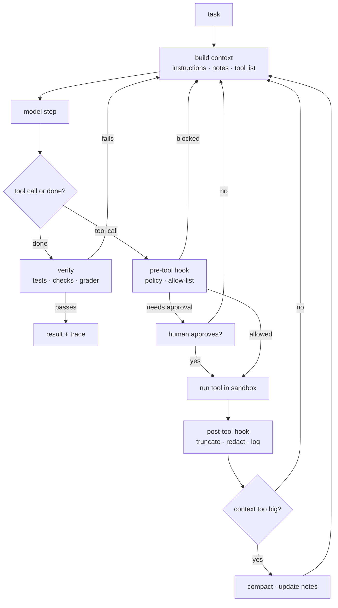
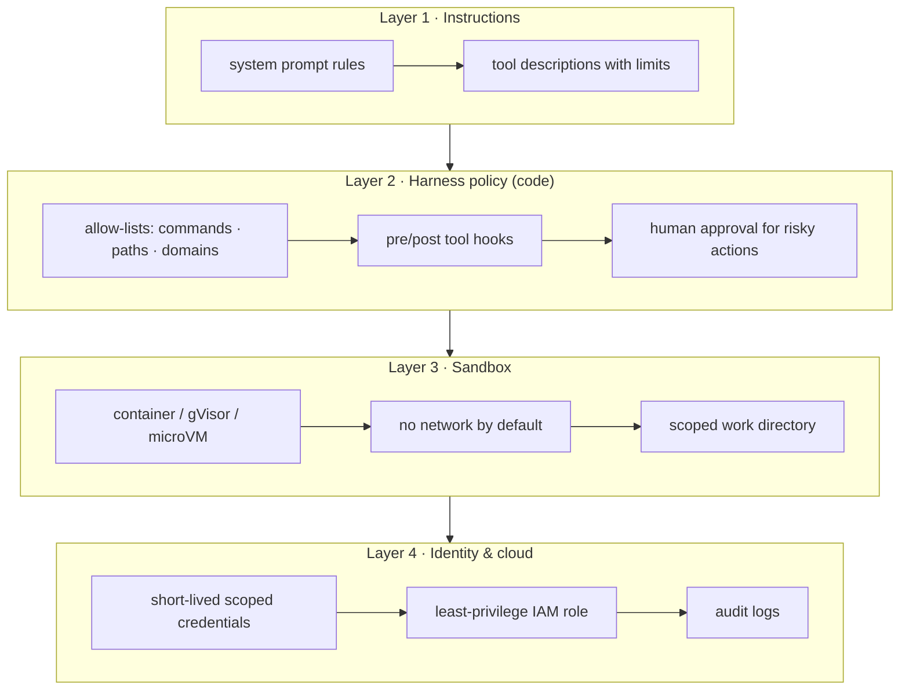

## What a harness is

Think of the model as an engine and the harness as the rest of the car: steering, brakes, dashboard and seatbelts. The same engine can be safe and useful, or dangerous and useless, depending on what you build around it.

Every box outside "model step" is harness code you own. That's where reliability comes from.

## Tools are an interface for a model

SWE-agent's key finding was that agents do much better with interfaces designed *for them*: a file viewer that shows 100 lines with line numbers, a search that returns a short summary, an editor that runs a linter after each edit. The same lessons appear in Anthropic's tool-writing guide:

- **Fewer, higher-level tools.** `schedule_meeting` beats `list_users` + `list_events` + `create_event`.
- **Clear names and descriptions.** Write them as if for a new teammate; the description *is* the documentation.
- **Helpful errors.** `"No file at src/app.ts; did you mean src/app.tsx?"` teaches the model; a stack trace doesn't.
- **Concise outputs.** Paginate, truncate and filter by default; offer a "detailed" option.
- **Evaluate the tools.** Run real tasks and read the traces to see where the agent gets confused.

This is also how to think about MCP servers for integration platforms: an MCP server *is* an agent-computer interface. Good API design skills transfer directly.

## Layers of defence

Never rely on the model to police itself. Put deterministic layers between the model and the world, so that each layer limits the damage if the one above fails.

Simon Willison's **lethal trifecta** is the quickest risk check: if an agent has (1) access to private data, (2) exposure to untrusted content and (3) a way to send data out, a prompt injection can steal that data. Remove at least one of the three for any risky task.

## Measuring a harness

Agents are stochastic, so one success proves little. Two metrics help:

$$
\text{pass@}k = P(\text{at least one of } k \text{ tries succeeds}) \qquad \text{pass}^k = P(\text{all } k \text{ tries succeed})
$$

pass@k tells you whether the agent *can* solve a task; pass^k (from τ-bench) tells you whether it *reliably* does. If each try succeeds independently with probability $p$, then $\text{pass}^k = p^k$. A 90%-reliable agent passes all of 5 tries only about 59% of the time. Users experience pass^k.

A good eval harness has:

1. **Reproducible environments**: containers or snapshots, so every run starts from the same state.
2. **Automatic graders**: unit tests, state checks, or a validated LLM judge.
3. **Cost and step tracking** per task, not just success.
4. **Failure categories** from reading traces: wrong tool, lost context, gave up early, unsafe action blocked.

## One agent or many?

Cognition argues for single-threaded agents: when sub-agents can't see each other's decisions, they make conflicting choices. Anthropic's research system shows that parallel sub-agents help on broad tasks like research, at several times the token cost. A practical rule: **use sub-agents for read-only exploration that returns a summary; keep writes and decisions in one agent with one shared context.**

## Long-running work

For tasks that span many context windows or sessions, Anthropic's long-running harness pattern is a good template:

- An **initialiser** step sets up the environment, a feature or task list, and a progress file.
- Each session **reads progress first**, works on one item, runs tests, commits, and **updates the progress file** before ending.
- Clean, tested checkpoints mean the next session never inherits a broken state.

It is the same discipline a good engineer uses when handing work to a teammate, written down so an agent can follow it.
