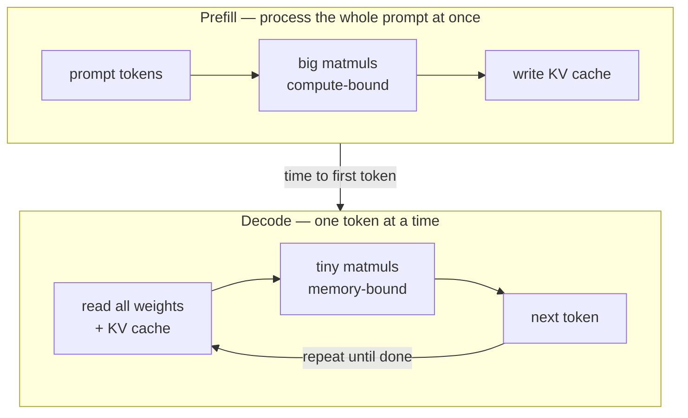

## Where inference time goes

An LLM request has two phases with very different performance:

**Prefill** processes many tokens in parallel, so it keeps the tensor cores busy. **Decode** generates one token per step but must stream every weight (and the KV cache) from memory each time. Most serving tricks attack decode's memory problem: batching more sequences together, shrinking the weights (quantisation), shrinking the KV cache (GQA, MLA, paging), or producing several tokens per weight-read (speculative decoding).

## The roofline model

The **arithmetic intensity** of an operation is the work done per byte moved:

$$
I = \frac{\text{FLOPs}}{\text{bytes moved}}
$$

A GPU has a peak compute $P$ (FLOP/s) and a memory bandwidth $B$ (bytes/s). Achievable performance is

$$
\text{performance} = \min\left(P,\ I \cdot B\right)
$$

The crossover point $I^\star = P / B$ is the *ridge point*. For a modern data-centre GPU with roughly $10^{15}$ bf16 FLOP/s and about $3 \times 10^{12}$ bytes/s of HBM bandwidth, $I^\star \approx 300$ FLOPs per byte. A matrix–vector product at batch size 1 has $I \approx 1$, so it uses well under 1% of the compute. That's why batching helps so much: a batch of $b$ sequences reuses each weight $b$ times and raises intensity roughly $b$-fold.

## The KV cache is the memory budget

During decoding each layer stores a key and a value vector for every previous token. Its size is

$$
\text{KV bytes} = 2 \cdot n_{\text{layers}} \cdot n_{\text{kv heads}} \cdot d_{\text{head}} \cdot L_{\text{seq}} \cdot b \cdot \text{bytes per element}
$$

**Example:** a Llama-3-8B-style model has 32 layers, 8 KV heads (thanks to GQA) and $d_{\text{head}} = 128$. In bf16 that's $2 \cdot 32 \cdot 8 \cdot 128 \cdot 2 = 131{,}072$ bytes ≈ 128 KiB **per token**. A batch of 16 sequences at 8k tokens needs about 16 GiB, the same order as the 16 GB of weights. Without GQA (32 KV heads) it would be four times larger. This is why PagedAttention (no wasted, fragmented cache memory) and prefix caching (share the cache for common system prompts) give such large throughput gains.

## A quick upper bound on decode speed

At small batch sizes, each decode step reads all the weights once, so

$$
\text{tokens/s} \lesssim \frac{B}{\text{bytes of weights}}
$$

An 8B-parameter model in bf16 is about 16 GB; with about 3 TB/s of bandwidth that's at most roughly 190 tokens/s for a single sequence, whatever the FLOPs. Quantising to 4-bit cuts the bytes about 4×, which is why int4 models feel so much faster on the same hardware. The same formula explains on-device speeds: a laptop with 100–400 GB/s of memory bandwidth running a 4 GB model tops out around 25–100 tokens/s.

## Kernels: from Triton to CUDA

Start in **Triton**: you write block-level Python and the compiler handles threads and shared memory. Fused kernels such as softmax and RMSNorm give big wins because they cut round-trips to HBM. Move to **CUDA** when you need full control. Work through a matmul from naive to tiled to register-blocked, and learn coalescing, shared-memory tiling and occupancy along the way. FlashAttention is the capstone: it uses the same tiling ideas plus an *online softmax* that lets attention run block by block without ever storing the full $T \times T$ score matrix.

## On-device and edge AI

Running models on phones and laptops is the same discipline under tighter limits: a few GB of memory, a power budget, and an NPU or GPU that's shared with the rest of the device.

| Lever | What it does | Tools |
| --- | --- | --- |
| Smaller architecture | deep-and-thin sub-1B models | MobileLLM, Gemma 3n |
| Distillation | small model learns from a big one | Hinton et al. 2015 |
| Low-bit quantisation | 4-bit or lower weights | GGUF (llama.cpp), MLX, ExecuTorch |
| Runtime | uses the device's NPU/GPU | ExecuTorch, LiteRT, Core ML, ONNX Runtime |
| Platform models | OS-provided on-device LLMs | Apple Foundation Models framework, Gemini Nano |

The hybrid pattern is becoming standard: a small on-device model handles private, low-latency tasks and routes hard requests to the cloud. Designing that routing (latency, privacy, cost) is where the inference and [AI Engineering](/roadmaps/ai-engineering/) tracks meet.
