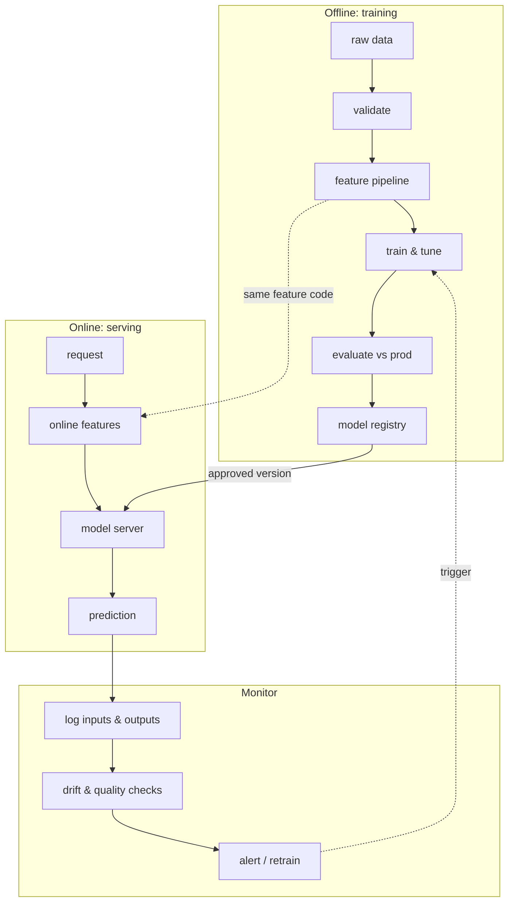

## The model is the small box

The most useful picture in MLOps comes from Google's *Hidden Technical Debt* paper: the ML code is a small part of a real ML system. Around it sit data collection, validation, feature extraction, serving, monitoring and configuration. Most production failures happen in those surrounding boxes.

The dotted "same feature code" line matters most. If training computes a feature one way and serving computes it another way (**training–serving skew**), the model quietly gets worse while every offline metric looks fine.

## Honest evaluation

Your validation score only means something if the validation data looks like the future the model will face.

- **Random splits** are fine for independent, identically distributed rows.
- **Time-based splits** are required when you predict the future: train on the past, validate on the period after it.
- **Group splits** keep all rows from one user or patient on the same side, so the model can't memorise individuals.

For imbalanced problems, precision and recall tell you more than accuracy:

$$
\text{precision} = \frac{TP}{TP + FP}, \qquad \text{recall} = \frac{TP}{TP + FN}, \qquad F_1 = \frac{2\,\text{precision}\cdot\text{recall}}{\text{precision} + \text{recall}}
$$

A fraud model with 99.9% accuracy can catch zero fraud if only 0.1% of transactions are fraudulent. Always report a baseline, and add confidence intervals (bootstrap the test set) before claiming one model beats another.

## MLOps maturity in three levels

Google's MLOps guide describes three levels. Use them to describe where a team is and what the next step is.

| Level | What it looks like | Typical pain |
| --- | --- | --- |
| 0 — manual | notebooks, hand-run training, models copied to servers | nobody can reproduce last month's model |
| 1 — pipeline automation | an orchestrated training pipeline retrains on new data | pipeline code changes are still deployed by hand |
| 2 — CI/CD of pipelines | pipeline code is tested and deployed automatically; models promoted by gates | needs platform investment and discipline |

Most teams should aim for level 1 first. Level 2 pays off once several models and people share the platform.

## Drift: when the world moves

Two kinds of change break deployed models:

- **Data drift:** the input distribution $p(x)$ changes, for example a new customer segment.
- **Concept drift:** the relationship $p(y \mid x)$ changes, for example fraudsters adapting.

A common drift score for one feature is the Population Stability Index across bins $i$, comparing the expected (training) share $e_i$ with the actual (production) share $a_i$:

$$
\text{PSI} = \sum_i (a_i - e_i)\,\ln\frac{a_i}{e_i}
$$

As a rule of thumb, PSI above about 0.2 deserves a look. Drift alerts are only useful if someone owns them, so decide who gets paged and which retraining or rollback playbook they follow before you turn alerts on.

## From MLOps to LLMOps

LLM applications reuse almost everything here: version the prompt, retrieval index and model together; put eval suites in CI as deployment gates; trace every request; watch cost per request alongside latency. The difference is that "accuracy" becomes a set of task-specific evals, which the [AI Engineering](/roadmaps/ai-engineering/) track covers.
