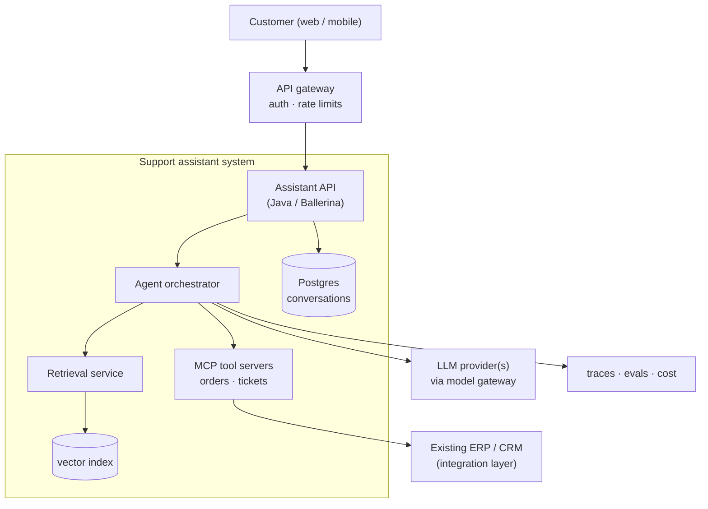
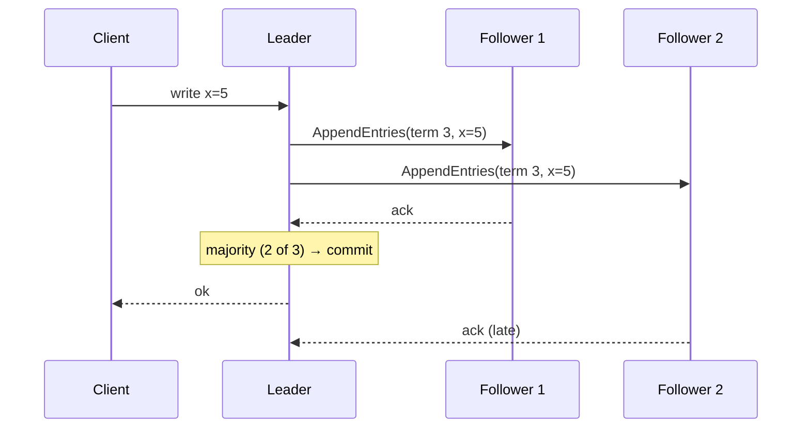

## Architecture is trade-offs, written down

Every architecture decision trades one quality for another. A cache buys latency and costs consistency. Microservices buy independent deployment and cost operational complexity. Async messaging buys resilience and costs debuggability. The work is to **name the trade** and **record it**.

An ADR is a short Markdown file in the repo:

```markdown
# ADR 007: Use a transactional outbox for order events

## Status
Accepted — 2026-11-07

## Context
Order service writes to Postgres and must publish OrderPlaced to Kafka.
Dual writes can lose or duplicate events when one side fails.

## Decision
Write events to an `outbox` table in the same transaction; a relay publishes them.

## Consequences
+ No lost events; consumers must be idempotent (at-least-once delivery).
− One more table and a relay process to operate; small publish delay.
```

## Draw at the right zoom level

The C4 model gives four zoom levels: **Context** (the system and its users), **Container** (deployable units and data stores), **Component** (modules inside a container) and **Code**. Most conversations need only the first two. Here is a container view of a typical AI-enabled service:



## Numbers you should be able to estimate

Rough estimation beats guessing. Two tools cover most cases.

**Little's law**, where $L$ is concurrent requests in the system, $\lambda$ the arrival rate and $W$ the time each spends inside:

$$
L = \lambda W
$$

At 200 requests/s and 1.5 s per LLM-backed request, you have about 300 requests in flight. That sizes your connection pools, worker counts and provider rate limits.

**Quorums** in leaderless replication (Dynamo-style), with $N$ replicas, $W$ write acknowledgements and $R$ replicas read:

$$
R + W > N \quad\Rightarrow\quad \text{every read overlaps the latest write}
$$

With $N = 3$, choosing $W = 2, R = 2$ tolerates one slow or failed node on both paths. $W = 1, R = 1$ is faster but can return stale data.

## CAP, and why PACELC is more useful

CAP says: during a network **P**artition you must choose **C**onsistency or **A**vailability. True, but partitions are rare. PACELC adds what matters day to day: **E**lse (no partition), you trade **L**atency against **C**onsistency.

| System style | During a partition | Normal operation | Example |
| --- | --- | --- | --- |
| PA/EL | stay available | favour low latency | Dynamo-style stores |
| PC/EC | stay consistent | pay latency for consistency | Spanner-style databases |
| PC/EL | consistent when it matters | fast reads from replicas | many leader-follower SQL setups |

Ask of any datastore: *what will my users see during a partition, and what does a normal read cost?*

## Consensus in one picture

Raft keeps a replicated log consistent across servers. A leader takes writes, replicates entries, and commits once a majority acknowledges. If the leader fails, followers time out and elect a new one, which must have every committed entry.



With $2f+1$ servers, Raft tolerates $f$ failures. That's why clusters come in sizes 3 and 5.

## Integration and event-driven design

Most enterprise work is integration: connecting systems that were never designed to talk. That's the world of WSO2 Micro Integrator, Ballerina and API managers. The core patterns:

- **API-led layers:** system APIs wrap backends, process APIs combine them, experience APIs serve each client.
- **Messaging patterns:** content-based router, message translator, aggregator, dead-letter channel.
- **Events vs commands:** an event says *this happened* (many consumers); a command says *do this* (one owner).
- **Sagas:** a long business transaction as local steps plus compensations, coordinated by orchestration or choreography.
- **Outbox + idempotent consumers:** the practical way to get exactly-once *effects* on top of at-least-once delivery.

## What changes with LLM systems

LLM components are slow, costly, non-deterministic and sometimes wrong. Architecture absorbs that:

1. **Model gateway:** one place for provider keys, routing, fallbacks, caching, rate limits and cost tracking.
2. **Evals as fitness functions:** run evaluation suites in CI, just as you run tests, and block regressions.
3. **Budgets per request:** latency, tokens and tool calls are part of the contract.
4. **Trust boundaries:** retrieved documents and tool outputs are untrusted input. See [AI Security & Safety](/roadmaps/ai-security-safety/).
5. **Workflows before agents:** prefer a fixed pipeline when the steps are known; reach for autonomous agents only where flexibility pays for the added risk.
