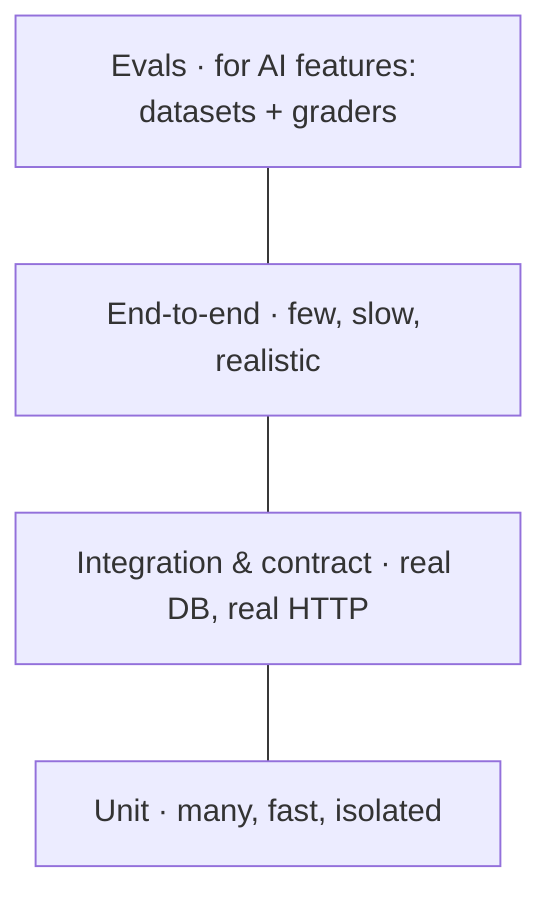
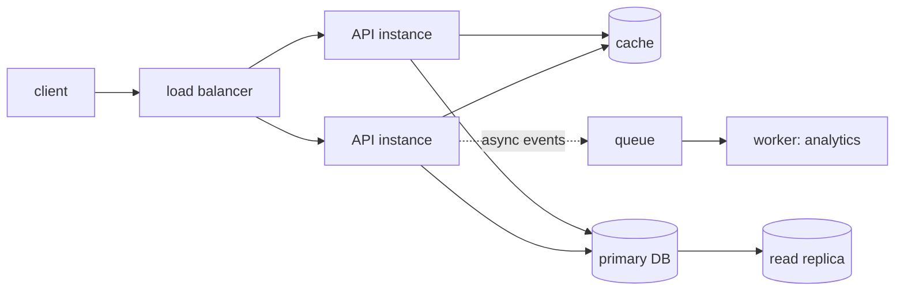

## What "good code" means in practice

Good code is code the next person (often you, in six months) can change safely. Three ideas cover most of it:

1. **Deep modules.** A module should hide a lot of complexity behind a small interface. `Files.readString(path)` is deep; a class that forces you to call five setters in the right order is shallow.
2. **Information hiding.** Each design decision (file format, retry policy, database choice) should live in one place, so changing it touches one module.
3. **Obvious code.** Naming and structure should make behaviour predictable. If a reviewer has to ask "what does this do?", the code (not a comment) needs work.

> **Rule of thumb:** if a change forces edits in many unrelated files, the design has leaked a decision. That's the moment to refactor, with tests in place first.

## Complexity: the one formula to internalise

Big-O describes how cost grows with input size $n$. The jumps between classes are enormous:

| Complexity | $n = 10^3$ | $n = 10^6$ | Typical example |
| --- | --- | --- | --- |
| $O(1)$ | 1 | 1 | hash-map lookup |
| $O(\log n)$ | ~10 | ~20 | binary search, B-tree index |
| $O(n)$ | $10^3$ | $10^6$ | one scan of a list |
| $O(n \log n)$ | ~$10^4$ | ~$2\times10^7$ | sorting |
| $O(n^2)$ | $10^6$ | $10^{12}$ | nested loops over all pairs |

At about $10^8$ simple operations per second, the $O(n^2)$ row at $n = 10^6$ takes hours, while $O(n \log n)$ takes a fraction of a second. Most real-world performance bugs are an accidental $O(n^2)$, such as a list lookup inside a loop or an N+1 query pattern against a database.

## The testing pyramid (with evals on top)

Write many fast unit tests, a solid layer of integration tests against real dependencies (Testcontainers makes this easy), and a few end-to-end tests of critical journeys. If your product includes an LLM, add **evals**: datasets of inputs with graders, run in CI like tests (see [AI Engineering](/roadmaps/ai-engineering/)).

Tests matter even more with AI coding agents. **A failing test is the clearest spec you can give an agent**, and a passing suite is how you know its output is done.

## System design: a repeatable method

Use the same five steps for every design question, whether in an interview or at work:

1. **Requirements:** functional ("shorten a URL") and non-functional (latency, availability, scale).
2. **Estimates:** back-of-the-envelope numbers. For example, 100M new URLs/month is about 40 writes/s; at a 10:1 read ratio that's 400 reads/s, and 500 bytes × 100M × 12 months is ~600 GB/year.
3. **API and data model:** endpoints, schemas, keys.
4. **High-level design:** the boxes and arrows.
5. **Deep dives and trade-offs:** the bottleneck, failure modes, consistency choices.

Availability multiplies down a chain of dependencies. Three services in series, each at 99.9%, give about $0.999^3 \approx 99.7\%$, or roughly 26 hours of downtime a year. That's why timeouts, retries, caches and graceful degradation matter.

## Delivery: CI/CD and the DORA metrics

A healthy pipeline builds, tests and deploys every change automatically, and makes rollback boring. DORA's research tracks four metrics that predict team performance: **deployment frequency**, **lead time for changes**, **change failure rate** and **time to restore service**. Small batches, trunk-based development, fast tests and automated deployment improve all four together. Speed and stability are not a trade-off.

## Working with AI coding agents

Treat an agent like a fast, tireless junior colleague who has read everything and remembers nothing about your project:

- **Give it context:** a short conventions file in the repo, the commands to build and test, and links to the relevant modules.
- **Specify with tests:** write the acceptance test first, then ask for the implementation.
- **Keep diffs small:** one concern per task, reviewed like any human PR.
- **Automate the guardrails:** linters, type checks, pre-commit hooks and CI catch mistakes before you have to.
- **Stay the owner:** you're accountable for every line you merge. Read it, run it, understand it.

This is the everyday side of [Harness Engineering](/roadmaps/harness-engineering/), and it's quickly becoming a core professional skill.
